

### Računi i ponude, jednostavno.

**Više vremena za posao. Manje administracije.**

Sve što vam treba za pripremu ponuda i računa, evidenciju klijenata i pregled naplate — jednostavno i pregledno na Android uređaju.

[**Preuzmite Fakturivu**](https://github.com/bren-wp/Fakturiva/releases) · [**Upoznajte mogućnosti**](#sve-za-uredno-poslovanje)

## Sve za uredno poslovanje

| 🧾 **Računi** | 📑 **Ponude** | 👥 **Klijenti** |
| :-- | :-- | :-- |
| Sastavite račun, uredite nacrt i evidentirajte naplatu. | Izradite ponudu, pregledajte je i pretvorite u račun. | Sačuvajte kontakte, adrese i identifikacijske podatke partnera. |

| 🛍️ **Artikli i usluge** | 📊 **Izvještaji** | 📄 **PDF** |
| :-- | :-- | :-- |
| Pripremite katalog proizvoda, usluga i cijena. | Pratite dokumente, uplate i nenaplaćene iznose. | Spremite i podijelite čitljive dokumente izravno s uređaja. |

## Profesionalni dokumenti s vašim identitetom

**Fakturiva prilagođava dokumente vašem poslovanju.** Unesite naziv tvrtke ili obrta, OIB, PDV ID, adresu, grad, poštanski broj, državu, kontakt, IBAN, banku, SWIFT, podatke o registru i porezne napomene. Na računima i ponudama prikazuju se izdavatelj, klijent, datum izdavanja i datum usluge, stavke, porezne stope i iznosi te podaci za plaćanje.

Kad potvrdite dokument, podaci izdavatelja i klijenta ostaju zabilježeni u dokumentu. Naknadne promjene profila ne mijenjaju povijesne račune.

## Čuvanje dokumenata i vaša privatnost

- 🔒 **Bez obvezne prijave i oblaka** — aplikacija radi lokalno, bez dozvole za internet.
- 💾 **Automatsko čuvanje nacrta** — nastavite rad nakon prekida.
- 🛡️ **Više lokalnih šifriranih kopija** — dodatan sloj oporavka ako je jedna datoteka oštećena.
- 📤 **Šifrirani prijenosni izvoz** — napravite kopiju na mjesto koje sami odaberete.
- 🌙 **Svijetla i tamna tema** — ugodan pregled na telefonu.

> Za zaštitu od krađe, kvara, brisanja aplikacije ili gubitka uređaja redovito izvezite šifriranu sigurnosnu kopiju **izvan telefona**. Samo lokalna pohrana ne može jamčiti očuvanje svakog podatka u svim okolnostima.

## Izgled Fakturive

**Fakturiva by Brendigo**

Tamnoplava, električno plava, tirkizni naglasci i jednostavna navigacija — poznato Android iskustvo na hrvatskom jeziku.

### Fakturiva u svakodnevnom poslovanju

  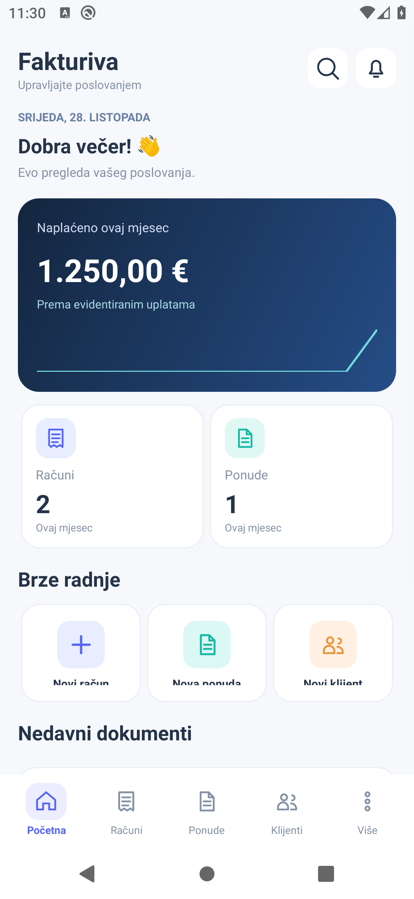
  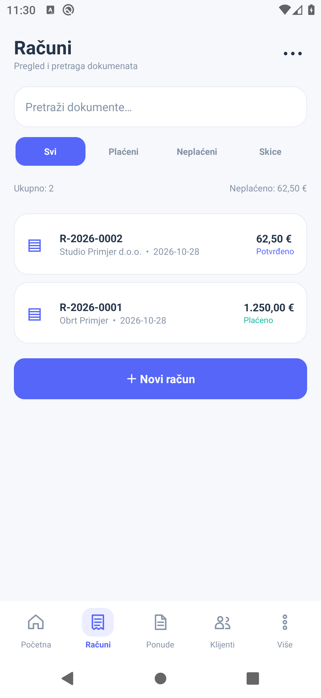
  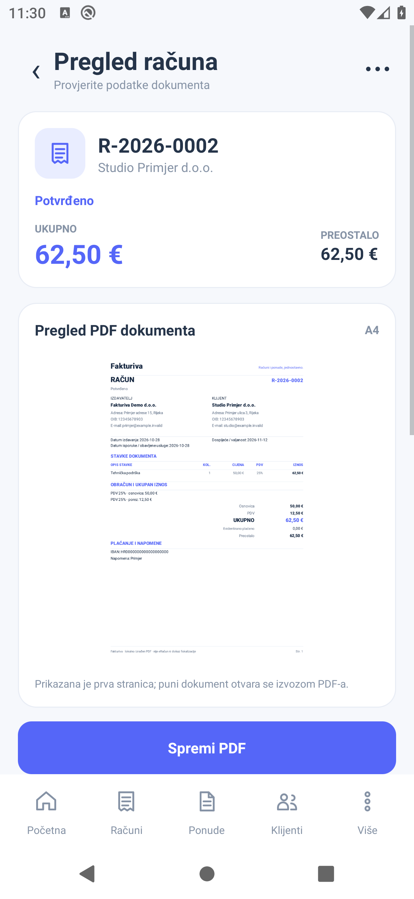

  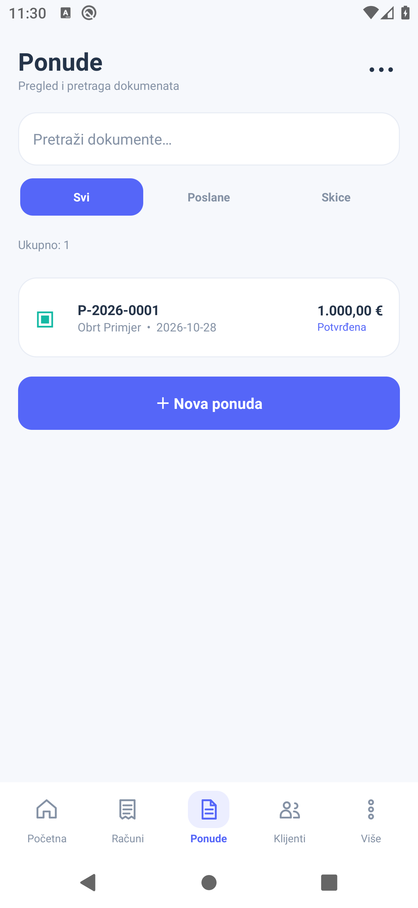
  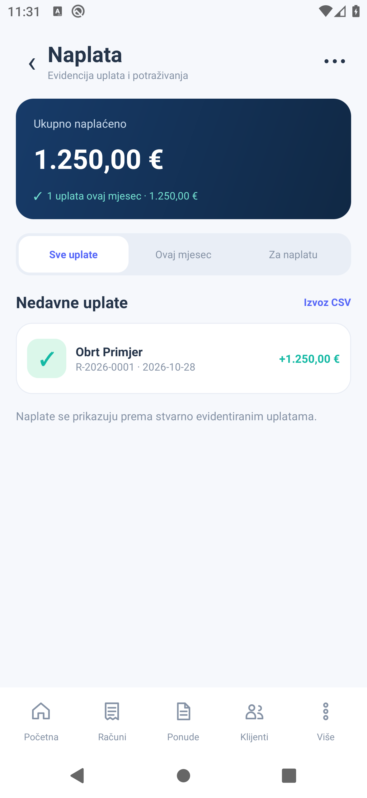
  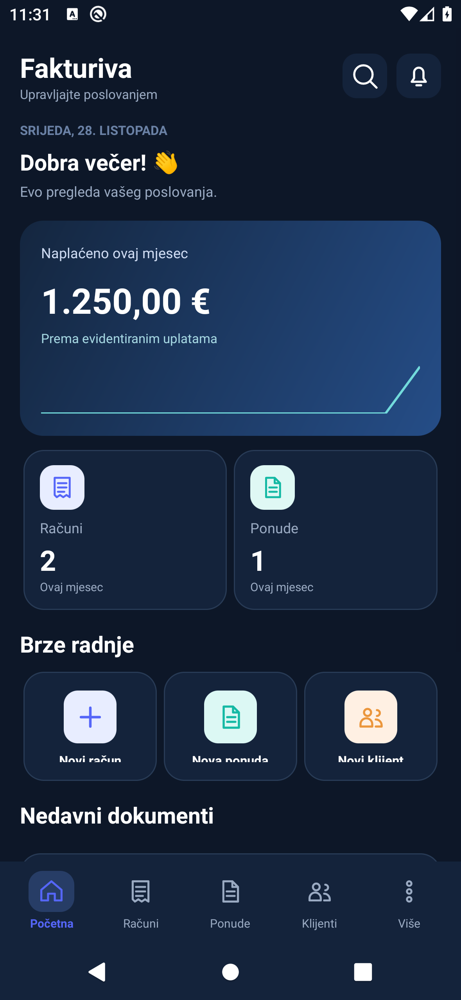

<b>Pogledajte svih 20 zaslona aplikacije</b>

  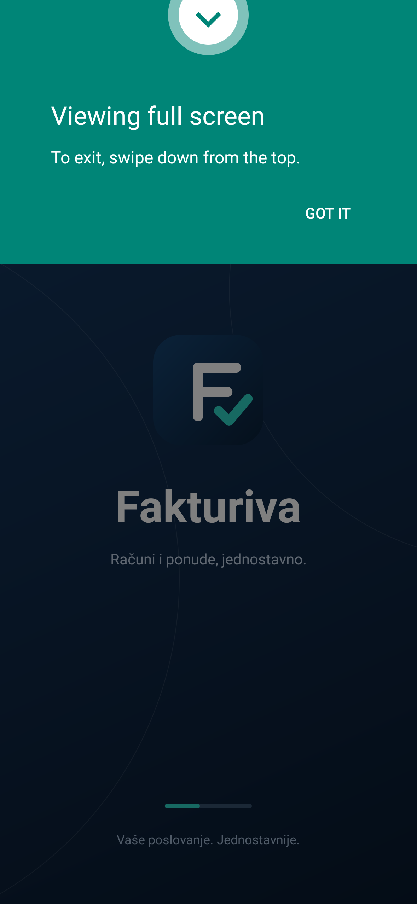
  
  
  

  
  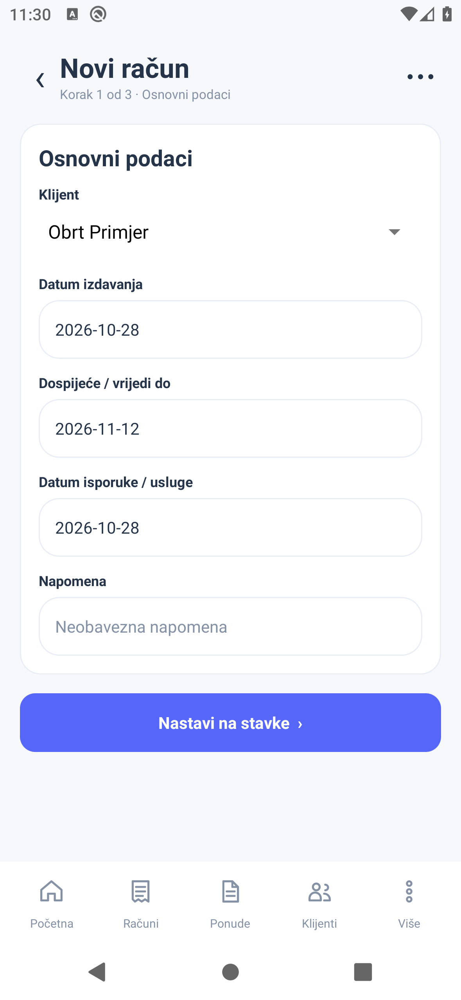
  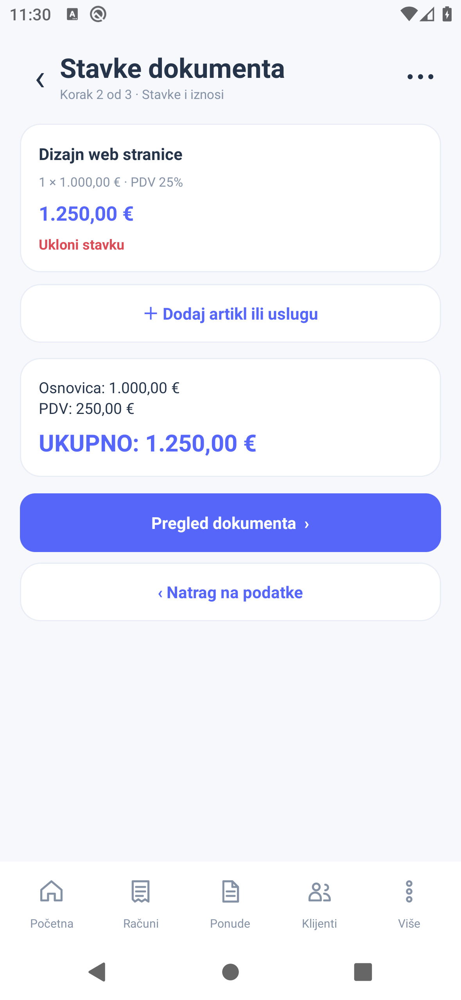
  

  
  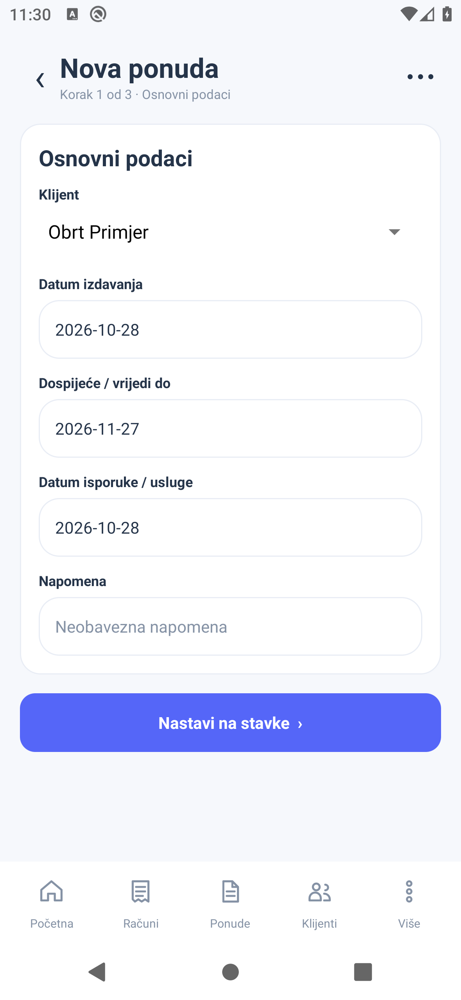
  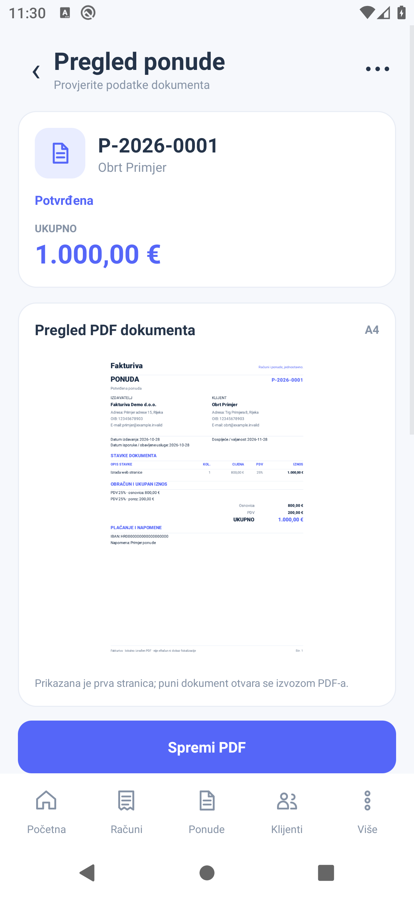
  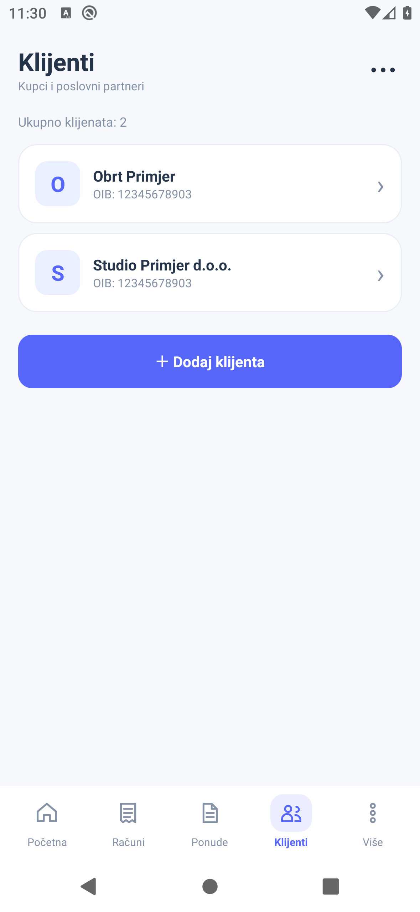

  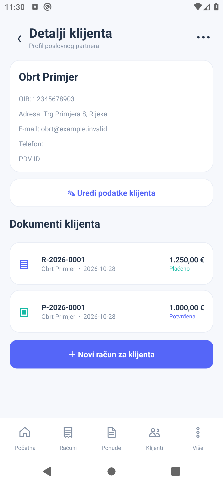
  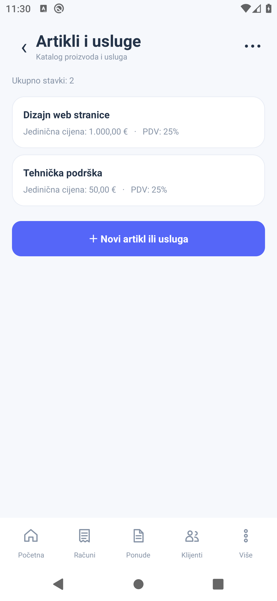
  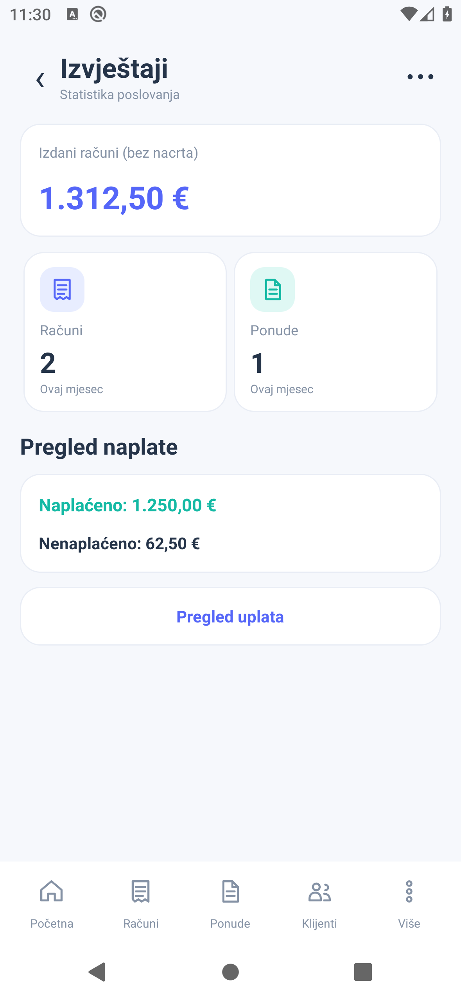
  

  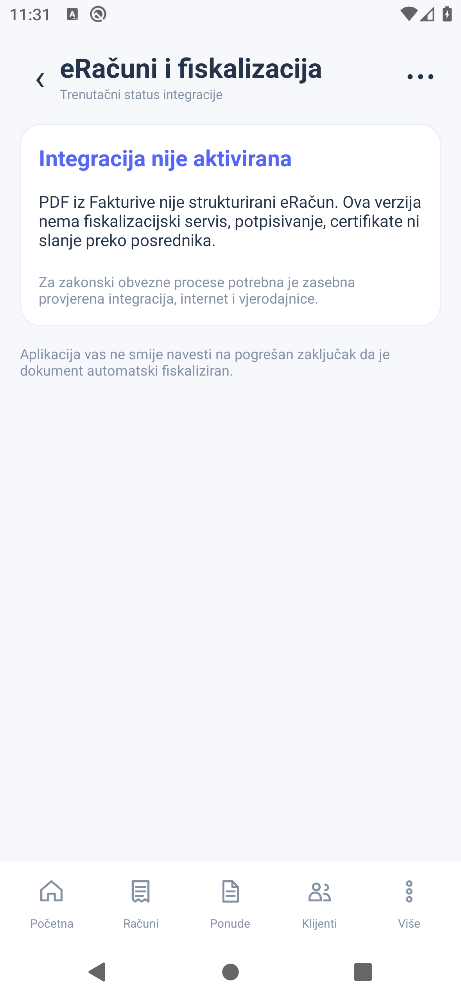
  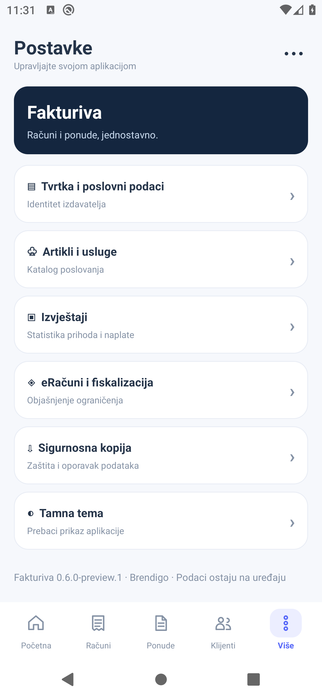
  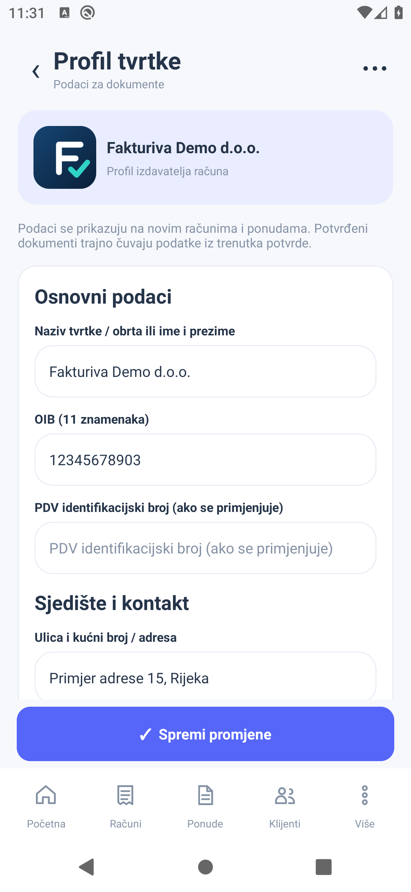
  

Svi prikazi su **stvarne snimke nativne Android aplikacije na emulatoru**, bez generiranih marketinških maketa. Aplikacija se kontinuirano usklađuje s referentnim dizajnom.

## Preuzimanje

[**GitHub izdanja za Android (APK i AAB)**](https://github.com/bren-wp/Fakturiva/releases)

Android 7.0 ili noviji. Uz svako izdanje navedeno je je li APK debug-potpisan i je li AAB potpisan za produkcijsko izdavanje. Izravni Play Store upload zahtijeva odgovarajući postojeći ključ i dodatne produkcijske provjere.

**Važno za hrvatsko tržište:** Fakturiva trenutačno ne provodi fiskalizaciju ni razmjenu strukturiranih eRačuna. Izvezeni PDF nije fiskaliziran račun niti strukturirani eRačun. Prije korištenja u zakonski obveznim poslovnim procesima treba implementirati i provjeriti primjenjive zakonske zahtjeve.

---

**Fakturiva** · Brendigo

*Računi i ponude, jednostavno.*

