

### Manje papirologije. Više vremena za posao.

**Fakturiva** je pregledna Android aplikacija na hrvatskom jeziku za izradu računa i ponuda, organizaciju klijenata, praćenje naplate i poslovnih evidencija — sve na vašem uređaju.

[**Preuzmite Android izdanje**](https://github.com/bren-wp/Fakturiva/releases) · [**Pogledajte aplikaciju**](#pogledajte-fakturivu-u-radu) · [**Kako radi**](#od-ponude-do-naplate)

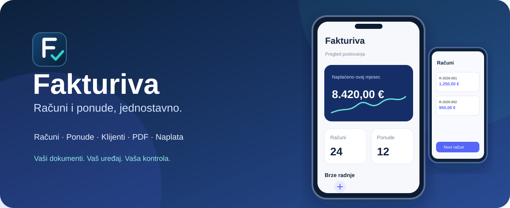

## Poslovanje na jednom mjestu

| 🧾 Računi | 📋 Ponude | 👥 Klijenti |
| :--- | :--- | :--- |
| Izradite račun, uredite stavke i iznose, pregledajte dokument te evidentirajte uplate. | Pripremite profesionalnu ponudu, uređujte stavke i pretvorite prihvaćenu ponudu u račun. | Pronađite kontakte, poslovne podatke i povezane dokumente na jednom mjestu. |

| 🏷️ Artikli i usluge | 📈 Poslovni pregled | 📄 PDF dokumenti |
| :--- | :--- | :--- |
| Vodite katalog s cijenama, jedinicama, kategorijama i poreznim stopama. | Pratite mjesečne pokazatelje, račune, ponude i stvarno evidentirane uplate. | Pregledajte, izvezite i podijelite račune i ponude iz Android aplikacije. |

## Od ponude do naplate

**1. Postavite podatke svojeg poslovanja.** Dodajte naziv tvrtke ili obrta, OIB, adresu, kontakte, IBAN i druge podatke relevantne za izdavanje dokumenata.

**2. Odaberite klijenta i izradite dokument.** Dodajte stavke, količine, cijene, PDV stope i rokove. Sve možete pregledati i urediti prije potvrde.

**3. Pošaljite PDF i pratite plaćanje.** Evidentirajte stvarne uplate i pratite neplaćene dokumente bez izmišljanja poslovnih pokazatelja.

Povijesni podaci izdavatelja i klijenta čuvaju se unutar potvrđenog dokumenta. Promjena profila ne prepisuje podatke u ranije izdanim računima.

## Pogledajte Fakturivu u radu

Ovo su **autentične snimke Android aplikacije**, a ne dizajnerske makete. Snimljene su na emulatoru u testnom okruženju. Poslovni podaci na njima služe isključivo demonstraciji izgleda i toka rada.

<table>
<tr>
<td align="center">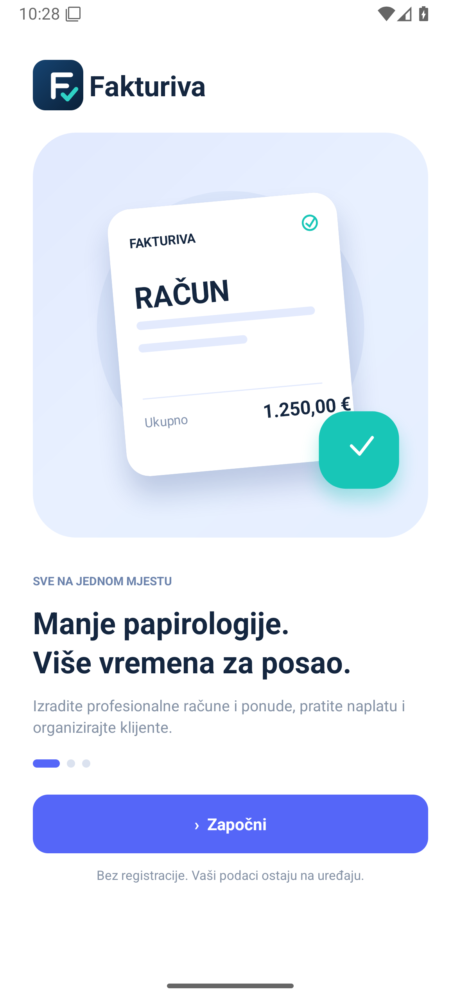 <b>Jednostavan početak</b></td>
<td align="center">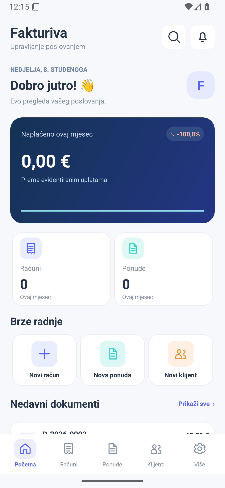 <b>Sve važno na početnoj</b></td>
<td align="center">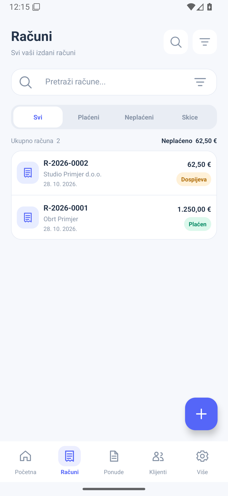 <b>Računi bez traženja</b></td>
</tr>
<tr>
<td align="center">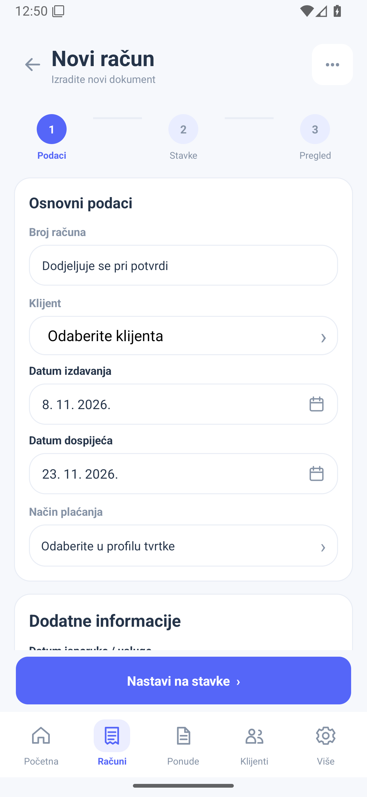 <b>Račun korak po korak</b></td>
<td align="center">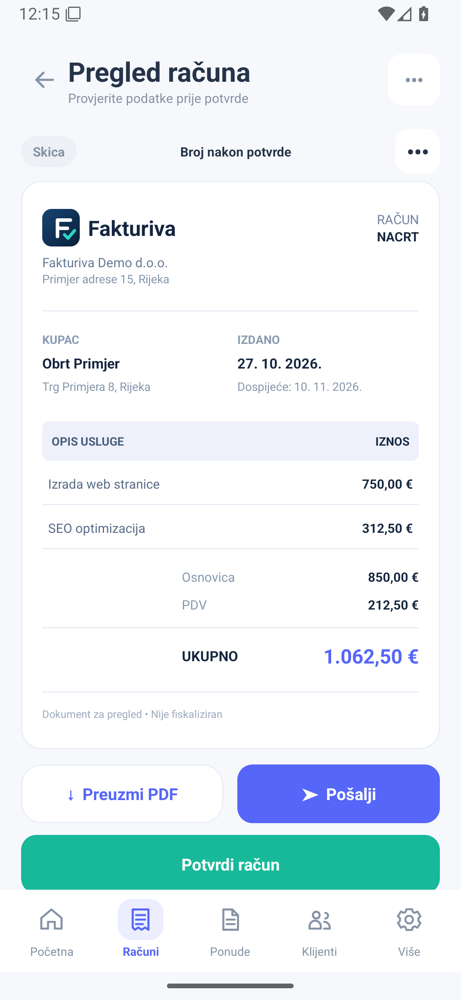 <b>Pregled prije slanja</b></td>
<td align="center">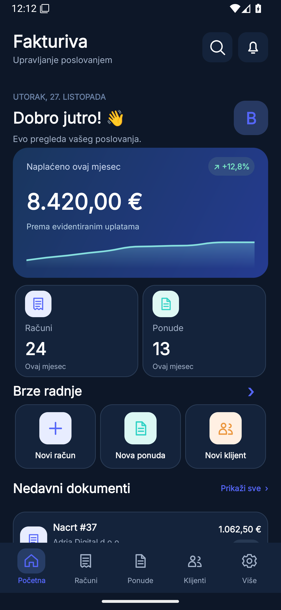 <b>Ugodna tamna tema</b></td>
</tr>
</table>

<b>📱 Pogledajte svih 20 zaslona</b>

| Početak i navigacija | Dokumenti | Poslovanje i postavke |
| :---: | :---: | :---: |
| 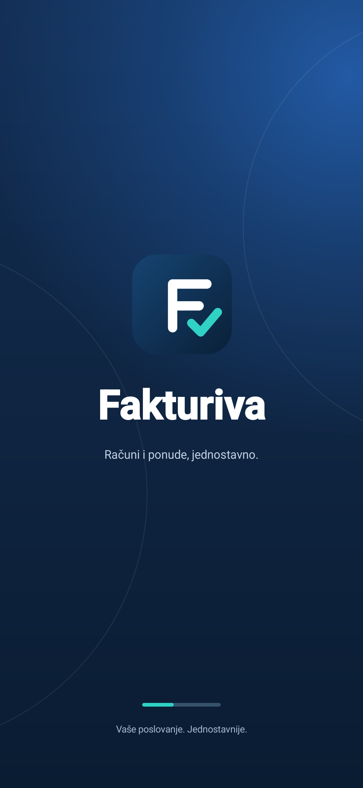 01 · Splash |  06 · Novi račun | 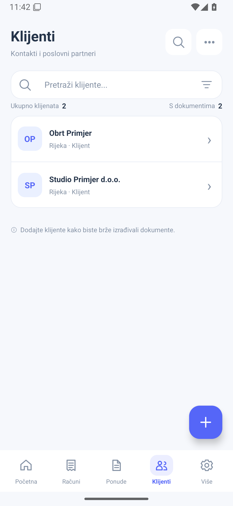 12 · Klijenti |
|  02 · Dobrodošli | 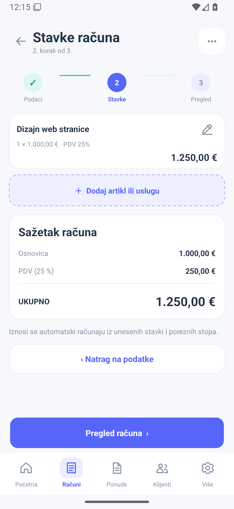 07 · Stavke računa | 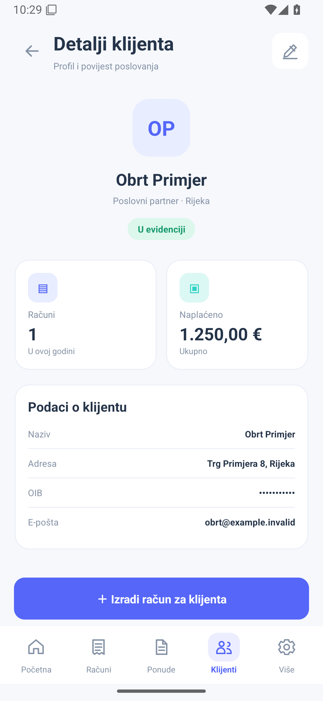 13 · Detalji klijenta |
| 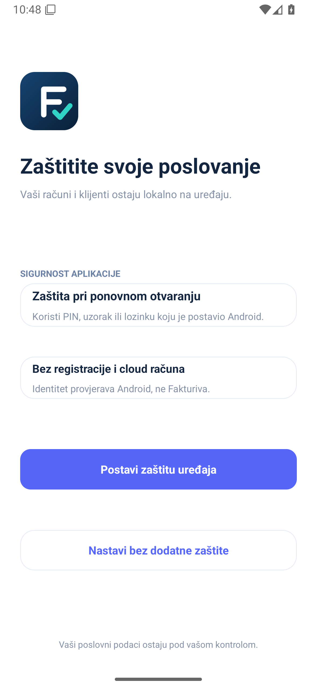 03 · Lokalna zaštita |  08 · Pregled računa | 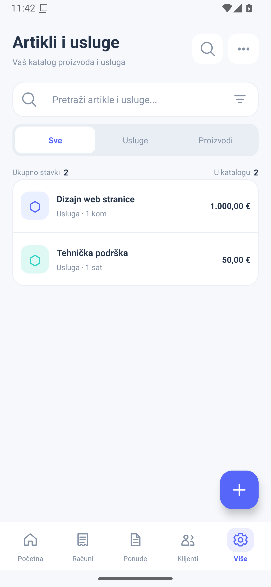 14 · Artikli i usluge |
|  04 · Početna | 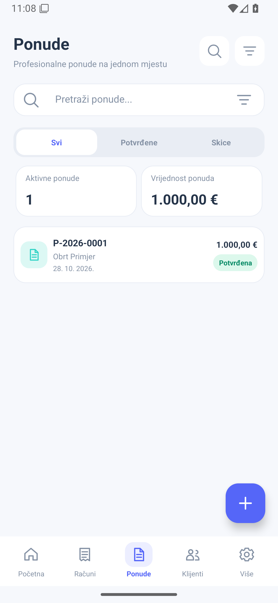 09 · Ponude | 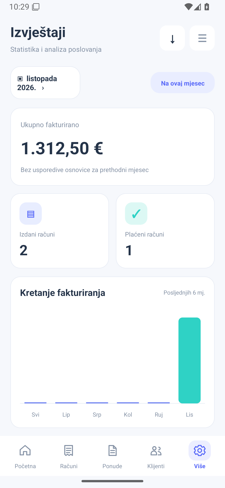 15 · Izvještaji |
|  05 · Računi | 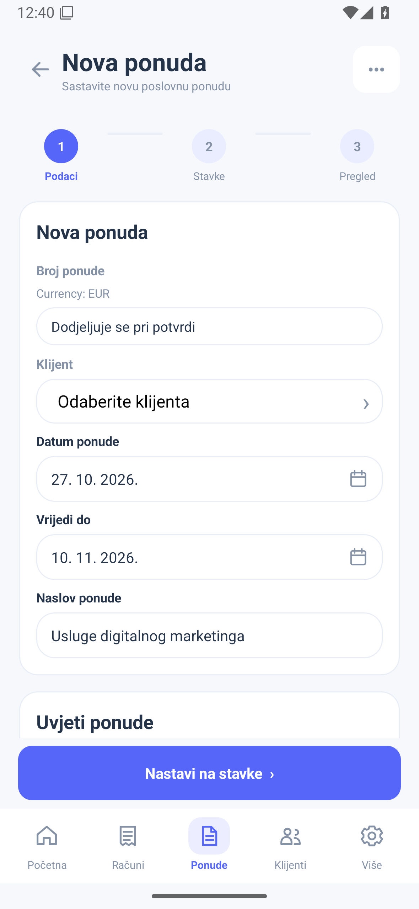 10 · Nova ponuda | 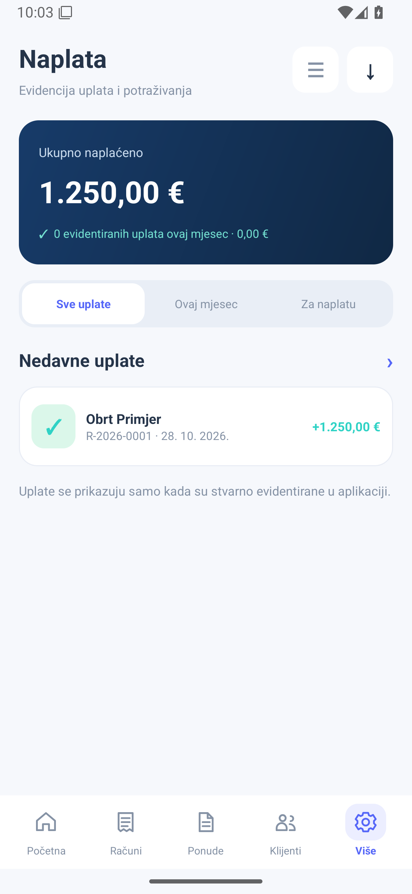 16 · Naplata |
| 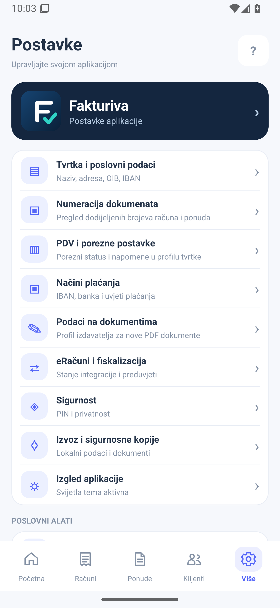 18 · Postavke | 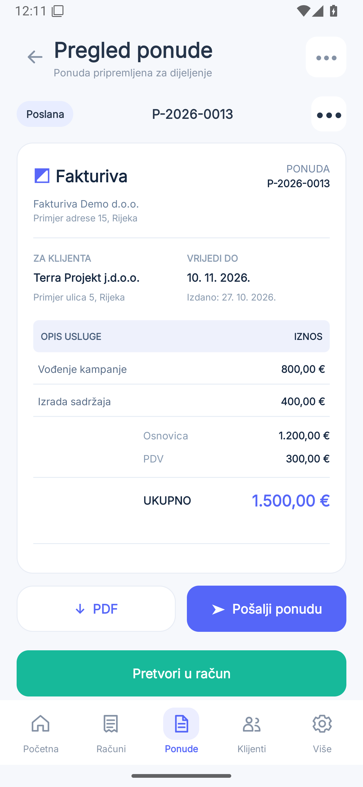 11 · Pregled ponude | 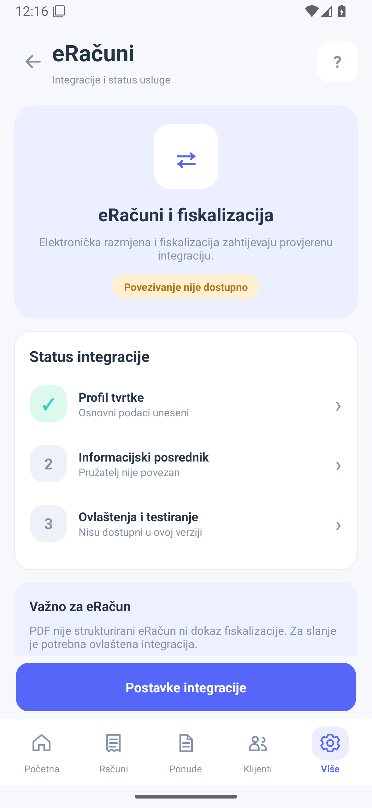 17 · eRačuni (bez aktivne integracije) |
| 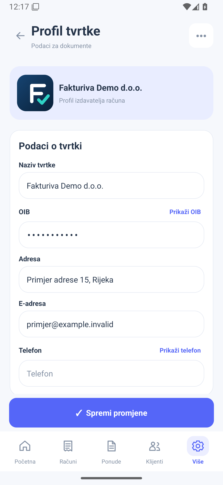 19 · Profil tvrtke |  20 · Tamna tema | |

## Vaši podaci pod vašom kontrolom

- **Radi lokalno:** nema obvezne registracije niti cloud računa; aplikacija ne traži internetsku dozvolu.
- **Zaštita identiteta:** opcionalna potvrda identiteta putem Androidova zaključavanja uređaja. PIN ne pohranjuje Fakturiva.
- **Automatska pohrana nacrta:** nastavite rad gdje ste stali.
- **Šifrirane sigurnosne kopije:** izvezite podatke na lokaciju koju sami odaberete i sačuvajte ih izvan uređaja.
- **Prilagodljiv izgled:** svijetla i tamna tema te podrška za različite veličine Android zaslona.

**Preporuka:** redovito izvezite i provjerite šifriranu sigurnosnu kopiju izvan telefona. Lokalna pohrana nije zaštita od svih vrsta gubitka ili oštećenja uređaja.

## Preuzmite Fakturivu za Android

[**Sva GitHub izdanja i datoteke za preuzimanje**](https://github.com/bren-wp/Fakturiva/releases)

**Novo:** [Fakturiva v0.13.0-preview.1 — Android pretpregled](https://github.com/bren-wp/Fakturiva/releases/tag/v0.13.0-preview.1)

**U izdanju v0.13:** dodatno polirani nativni zasloni **09 Ponude**, **10 Nova ponuda** i **11 Pregled ponude**. Usklađeni su redovi ponuda, razmaci koraka i polja te visina papirnatog pregleda, bez zamjene stvarnih iznosa ili podataka iz SQLite baze. Stvarni PDF, slanje i pretvaranje potvrđene ponude u nacrt računa ostaju dostupni.

| Datoteka | Namjena |
| :--- | :--- |
| **debug.apk** | Instalacijski paket za isprobavanje aplikacije na Androidu 7.0 ili novijem. |
| **DEBUG-SIGNED.aab** | Testni Android App Bundle, nije potpisan produkcijskim Google Play ključem. |
| **UNSIGNED.aab** | Bundle koji prije objave treba valjano produkcijski potpisati. |
| **SHA256SUMS.txt** | Provjera integriteta preuzetih paketa. |

Ako već koristite razvojnu verziju, potpisni ključ novog APK-a možda neće odgovarati postojećoj instalaciji. **Prije deinstalacije ili zamjene obavezno izvezite i provjerite sigurnosnu kopiju podataka.**

### Važna informacija za poslovne korisnike u Hrvatskoj

Fakturiva zasad **ne provodi fiskalizaciju ni stvarnu razmjenu strukturiranih eRačuna**. PDF nije automatski fiskalizirani račun ni strukturirani eRačun. Funkcionalnosti koje podliježu zakonskoj obvezi potrebno je zasebno implementirati i provjeriti prije produkcijske uporabe za takve procese.

## Kvaliteta sučelja i stvarne snimke

Sučelje se razvija **ekran po ekran**, uz originalne vlasnikove referentne PNG-ove, nativne Android komponente i automatizirane screenshot testove. Stvarne snimke svih 20 zaslona prikupljaju se na Android emulatoru; matrica provjerava 9 konfiguracija zaslona, uključujući manje telefone, tablete, povećani tekst i pejzažni način.

Točna matematička podudarnost od **0 % odstupanja nije potvrđena**. Razlike u stvarnim poslovnim podacima, sustavnim elementima, vremenu i fontovima nisu prikrivene statičnim maketama. [Detalji i porijeklo snimki](docs/SCREENSHOTS.md).

---

**Fakturiva by [Brendigo](https://brendigo.com)**

*Računi i ponude, jednostavno.*

